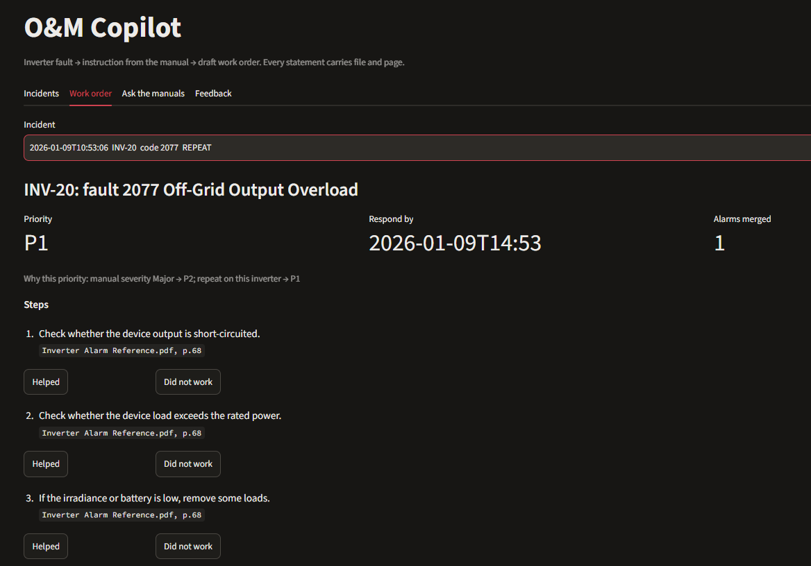
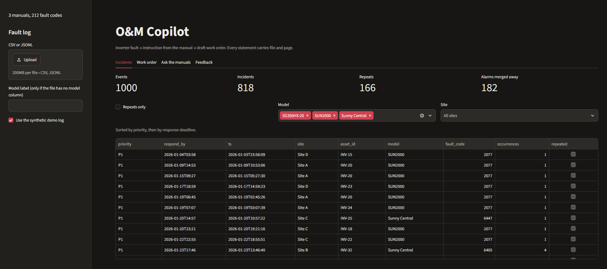
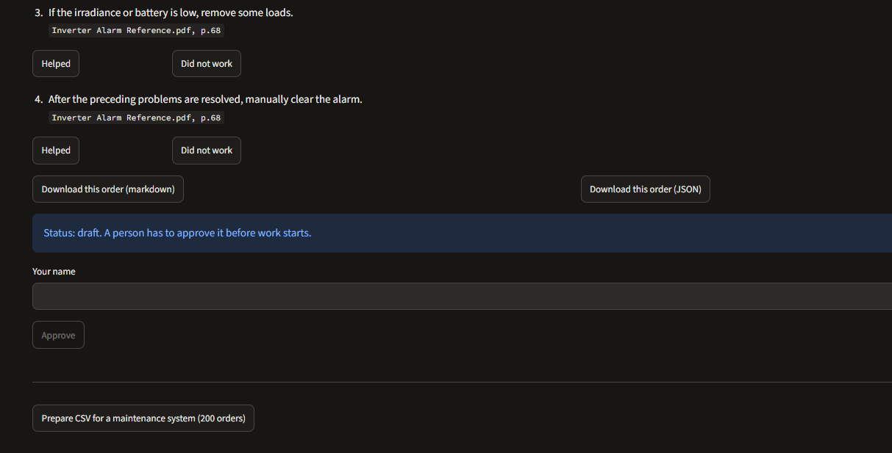
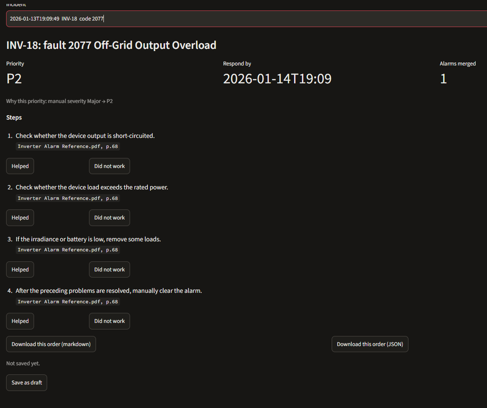
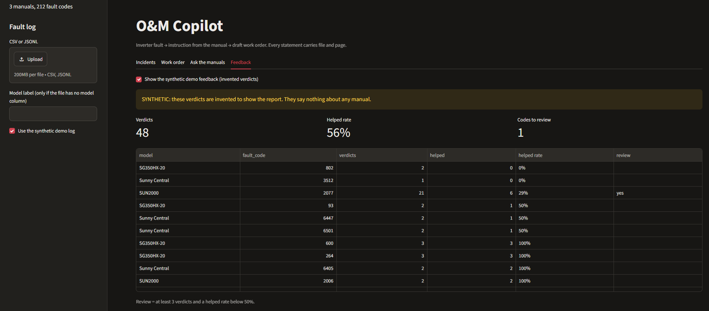
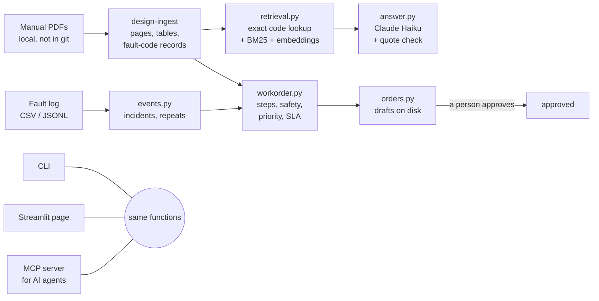

# O&M Copilot

**An inverter fault goes in. The matching instruction from the manufacturer's manual and a draft work order come out, and every statement carries the file and page it came from.** If the manuals do not answer, the tool says so instead of guessing.



Status: working CLI, demo page (Streamlit) and MCP server; evaluated on 25 questions over three manuals from three manufacturers.

## What it does

A plant's SCADA system produces alarms, not jobs. A technician needs to know: is this one problem or fifty alarms from one storm, how urgent is it, what does the manufacturer say to check, and who signed it off. The Copilot answers these in five steps:

1. **Reads the manuals** (PDF) and extracts the fault-code tables: code, name, corrective measures, page.
2. **Reads a fault log** (CSV or JSONL, column names matched by alias) and turns the alarm stream into incidents: the same code on the same inverter within 6 hours is one incident; the third in 30 days is a repeat.
3. **Builds a draft work order** for each incident: the manual's own corrective measures and safety passages, each with file and page, plus a priority that explains itself and a respond-by time.
4. **Answers free questions** ("What do I check on fault 39?") with quotes that the code verifies against the passage they came from.
5. **Hands over to people.** The tool only writes drafts. Approval, assignment and "work done" are filled in by a named person; an AI agent has no tool to do it.

You can use it from the command line, from a browser page, or from an AI agent (Claude Desktop, Claude Code) through MCP.

## How it looks

The demo page (`om-copilot ui`) runs locally on a synthetic fault log. Screenshots show a few lines of one manufacturer's fault table exactly as the tool prints them; the manual itself is copyrighted by its owner and is not in this repository.

**The incident list.** One thousand synthetic alarms become 818 incidents: 182 alarms were merged into storms and 166 incidents are repeats. The table is sorted by priority, then by respond-by time, and can be filtered by model and site.



**An incident with a repeat.** Priority P1 and the reason: the manual rates the fault Major (P2) and the repeat on this inverter raises it one level. "Respond by" is the reported time plus the SLA of the final priority (P1: 4 hours). Every step names its file and page.

(The picture at the top of this page.)

**Approval is a person's action.** A saved draft shows its status. The Approve button stays grey until a name is typed; the tool records who approved, and an approved order is never overwritten.



**An incident that has not been saved yet.** Only P2 here (no repeat, one reason), and the only action is "Save as draft".



**Feedback from technicians.** Each step of a work order has "Helped" and "Did not work". The report shows the helped rate overall and per fault code and flags codes with at least 3 verdicts and a rate below 50% for a review of the manual page. The verdicts in this picture are **invented** (the yellow banner says so); they only show how the report looks.



## How it is built



The CLI, the web page and the MCP server are thin layers over the same functions, so a number shown in one place is the same number everywhere.

## Technologies and algorithms

| Part | What is used | Detail |
|---|---|---|
| Language, data models | Python 3.10+, pydantic v2 | Work orders, answers and citations are typed models; invalid data fails loudly |
| Reading PDFs | [design-ingest](https://github.com/owl-solar/design-ingest) (own package, pinned to tag v0.7.0) | Text per page, tables, and fault-code readers for three table layouts (Sungrow, Huawei, SMA); the Copilot never opens a PDF itself |
| Exact fault-code lookup | Own code, regular expressions | A number is a code only after a cue word (fault, alarm, error, event, code); ranges such as 448-479 match; a token like F0234 counts only if it equals a code in some manual's table |
| Keyword search | BM25 (k1 = 1.5, b = 0.75), offline | Strong on part names and exact terms |
| Semantic search | `BAAI/bge-small-en-v1.5` through fastembed, 64 MB, runs on your machine | Finds a passage when the question uses other words than the manual; downloaded once on request |
| Combining searches | Reciprocal rank fusion (k = 60, top 50 of each), then exact code hits go first | Embeddings blur numbers, so exact lookup fixes the order for codes |
| Answer writing | Anthropic Messages API, Claude Haiku 5.5 (`claude-haiku-5-5`) | Sees only the top 8 passages; the only paid step; blocked by default behind a guard in design-ingest that needs `--allow-external` and can enforce a token budget |
| Answer checking | Plain code | Every quote is compared with the passage it cites; reworded or invented quotes are flagged |
| Incidents | Time-window grouping | Same code on the same inverter within 6 h is one incident; 3 incidents in 30 days is a repeat; all numbers in `config_default.json` |
| Priority | Rule table, no model | Manual severity (Critical P1, Major P2, other P3), one level up for a large inverter (rated power at or above 1000 kW), one level up for a repeat; each step is written into the order; respond-by from the SLA table (P1 4 h, P2 24 h, P3 72 h) |
| Agent access | [Model Context Protocol](https://modelcontextprotocol.io), official Python SDK 2.x, stdio | Eight tools and one resource; only `propose_work_order` writes, and only a draft |
| Bounded agent (experiment) | Claude Haiku through an in-process MCP client | At most 5 tool rounds, then the final reply is forced; spending cap in USD |
| Demo page | Streamlit (optional extra) | Four tabs over the same functions |
| Export and audit | CSV (with BOM) and JSON | Each order has a stable id, the manual's file and pages, and the sha256 of that exact file |
| Test data | Own generator, seed 42 | 1000 synthetic events with planted alarm storms and chronic repeats, so checks know the right answer |
| Quality | pytest (96 tests), ruff | Tests use invented records only |

Outside services: the Anthropic API (only when you allow it and only for questions, never for work orders) and a one-time download of the embedding model. Nothing else leaves the machine; the manuals and the fault log stay local.

## Why it is useful

- **Every statement has a source.** Answers and work orders cite the manual and the page. The model
  must quote the manual word for word, and the code checks each quote against the passage it came
  from: 100% of citations were found in the cited passage in the evaluation.
- **It says "not found" instead of guessing.** For questions the manuals do not answer it refuses
  (3 of 3 in the evaluation) and says what is missing.
- **Fault codes are looked up exactly.** "Fault 39" goes straight to its table entry, not through
  fuzzy search: the right page is in the top 5 for all 22 answerable questions, and for fault codes
  it is first in 11 of 12 cases.
- **Work orders need no AI.** Steps are the manual's own corrective measures with their pages and
  the priority comes from a plain table: same input, same order, no cost, nothing invented.
- **People stay in charge.** Drafts only; approval is a named person's action, never the tool's or an agent's.

## Where AI is used, and where it is not

| Step | Method | Needs a model call? | What it gives |
|---|---|---|---|
| Read the PDFs, extract fault-code tables | Deterministic parsing (design-ingest) | No | Same result every run; 212 fault-code records from three manuals |
| Find a fault code named in the question | Exact lookup by number | No | Numbers are matched exactly, never "close enough" |
| Find passages by words | BM25 keyword search | No (offline) | Fast, explainable; strong on part names and exact terms |
| Find passages by meaning | Small local embedding model (bge-small, 64 MB) | No (runs on your machine) | Finds a passage when the question uses different words than the manual |
| Write the answer | Claude (Haiku), fed only the top passages | **Yes, the only paid step** | Short readable answer with quotes instead of a list of pages |
| Check the answer | Code compares every quote with its passage | No | Invented or reworded quotes are flagged |
| Work order | Template over the manual's own steps | No | Free, reproducible, no hallucinated steps |

Why the mix: keyword search alone put the right page in the top 5 for 77% of questions;
embeddings alone reached 95% but blurred numbers (fault codes first in only 58% of cases);
embeddings plus the exact code lookup reached 100% (92% first for codes). The model is used
once, at the end, and is never trusted without the quote check. Measured numbers for every stage,
including an agent and a "whole manuals in the prompt" baseline, are in [Comparing the stages](#comparing-the-stages).

## Data

Manufacturer manuals are copyrighted and **not** in this repository. Download them yourself and put them into `data/raw/` (git-ignored). Sources, versions and checksums are in [docs/sources.md](docs/sources.md). Only synthetic fault logs are used; there is no real plant data here.

## Setup

```bash
python -m venv .venv
.venv\Scripts\activate          # Windows
pip install -e ".[dev]"          # add ,ui and ,mcp for the demo page and the MCP server
copy .env.example .env          # then fill in ANTHROPIC_API_KEY if you want LLM answers
pytest
```

External model calls are off by default (design-ingest guard); they need an explicit opt-in and cost money.

## Use

```bash
om-copilot add-manual FILE.pdf --model ABC-1000   # add your own manual (see below)
om-copilot manuals                        # list the manuals with model label, fault codes, warnings
om-copilot ingest                         # parse the manuals, count pages and fault codes
om-copilot eval --mode hybrid             # retrieval metrics (free, offline)
om-copilot synth -n 1000 --seed 42        # synthetic fault log in data/synth/ (codes from the manuals)
om-copilot synth --csv data/synth/faults.csv   # the same log as a SCADA-style CSV (; separated, day.month.year)
om-copilot incidents data/synth/faults.csv     # 1000 events -> incidents: alarm storms merged, repeats marked
om-copilot workorder -n 5                 # draft work orders (JSON + markdown), no LLM, free
om-copilot ui                             # demo page in the browser (pip install -e .[ui] first)
om-copilot mcp                            # MCP server for Claude Desktop / Claude Code (pip install -e .[mcp])
om-copilot approve ID --by NAME           # a person approves a saved draft work order
om-copilot eval-agent                     # scripted agent on the synthetic log, checks (free)
om-copilot eval-agent-llm questions --allow-external   # PAID: Haiku calls the MCP tools on the 25 questions (about 2 cents)
om-copilot eval-agent-llm log --allow-external         # PAID: the chronic-repeat task on the synthetic log
om-copilot export                         # all work orders -> one CSV and one JSON for a maintenance system
om-copilot feedback ID --step 2 --failed  # a technician marks a step: --helped or --failed
om-copilot feedback-report                # helped rate overall and per fault code, worst first
om-copilot ask "SG350HX shows fault 39. What should I check?" --allow-external      # one paid call
om-copilot eval-answers --allow-external  # 25 paid calls, about 1.5 cents with claude-haiku-5-5
```

## Add your own manual

Manuals of other manufacturers or models work the same way as the three used for the evaluation.

1. **Add it:** `om-copilot add-manual "C:\path\to\Manual.pdf" --model ABC-1000`.
   The PDF is copied to `data/raw/`, read, and checked; the model label (`ABC-1000`, the value your fault
   log has in `model`) is saved in `data/config.local.json` (git-ignored). Without `--model` the file name is used.
2. **Read the report.** It shows pages, fault codes found and what needs attention:
   - fault codes > 0: questions, exact code lookup and work orders all work for this manual;
   - severity words the priority table does not know: add them under `"priority"` in `data/config.local.json`,
     for example `{"priority": {"severe": "P1"}}` (unknown words get P3);
   - 0 fault codes: see below.
3. **See everything at once:** `om-copilot manuals` lists all manuals with label, codes and warnings.
4. **Note the source** in `docs/sources.md` (the command prints the line with the sha256). Do not commit the PDF.

Then use it: `om-copilot ask "..."`, `om-copilot workorder` with a fault log whose `model` is the label.
One manual that covers a whole series (for example three inverter sizes) gets one label; a different series
with its own manual gets its own. The same code number in two manuals is fine: work orders look it up in the
manual of the record's model.

**If no fault codes were found.** Free questions still work through text search, but the exact code lookup
and work orders do not. Fault-code tables are recognised by headings such as Fault Code / Fault Name /
Corrective Measures (also Error, Alarm, Remedy, Action) and by ruled rows. A different layout needs a reader in
[design-ingest](https://github.com/owl-solar/design-ingest) (add it there with a test, release a tag, raise the
pin in `pyproject.toml`); it is deliberately not worked around here.

Limits: English manuals only for now, PDFs with a text layer (no scans).

## Results (three manuals: Sungrow string, Huawei alarm reference, SMA utility inverter)

| Step | Measure | Result |
|---|---|---|
| Retrieval, BM25 only | hit@5 / MRR on 22 answerable questions | 0.77 / 0.76 |
| Retrieval, hybrid + exact code lookup | hit@5 / MRR | 1.00 / 0.83 |
| Answers (Claude Haiku) | citations verified word for word | 100% |
| | answers with an expected page cited | 22 of 22 |
| | questions without an answer refused | 3 of 3 |

The questions and expected pages are in `eval/questions.json` (checked by hand against the PDFs). The check that answers contain key words from the manual reads them from a local file, `data/must_contain.json` (`{"q01": ["word", ...]}`, git-ignored because the words come from the manuals); without it that one check is skipped and the others run as usual.

## Compared with "all manuals in the prompt"

The obvious alternative is no retrieval at all: put the full text of every manual into the model's context
and ask. Same model (Claude Haiku), same 25 questions, same grading; the baseline gets the same page-labelled
text our pipeline reads (so table extraction is not held against it) and its quotes are checked against the
page it names. Command: `om-copilot eval-baseline --allow-external`.

| | This pipeline (8 passages) | Whole manuals in the prompt |
|---|---|---|
| Answered (22 answerable questions) | 22 | 22 |
| Every quote found on the page it names | **22 of 22** | 15 of 22 |
| Expected page cited | **22 of 22** | 14 of 22 (18 if other pages with a verified quote count) |
| Questions without an answer refused | 3 of 3 | 3 of 3 |
| Tokens per question | about 3 thousand | about 226 thousand |
| Cost of the 25 questions | about $0.013 | about $0.45 with prompt caching (about $2.80 without) |

What the baseline got wrong: of its 18 quotes that did not check out, 12 were real text on a neighbouring or
other page (mostly off by one page), and 6 were not in the cited file as quoted. Both break the "every
statement has a source you can open" promise, which is the point of this project. What this does **not**
show: one model (Haiku) and one run each, so a stronger model may cite pages better; answer fluency and
multi-section questions were not graded, and retrieval of only 8 passages can miss those where a model
reading everything might not.

## Examples (real runs, retold in my own words; the tool itself prints the manual's quotes)

**Question with a fault code** (`om-copilot ask "SG350HX shows fault 39. What should I check?"`):

```
Fault 39 (Low System Insulation Resistance): check the ISO resistance protection value, the resistance
to ground of the string and DC cable, and the battery cables; contact the manufacturer if nothing helps.
  [SG305HX_SG320HX-20_SG350HX-20 User Manual.pdf, p.131] quote found in the passage: yes
  (one citation per step; the quotes are shown by the tool, not reproduced here)
```

**Procedure question** ("How do I disconnect the inverter for maintenance?"): four steps (open the external AC breaker and secure it, turn the DC switch off, wait about 25 minutes for the capacitors to discharge, confirm with a clamp that the DC cable carries no current). Each step has a citation to p.136 of the same manual and every quote was verified in code.

**Question the manuals do not answer** ("... Fronius Symo error E306 ..."): `found=False`, no citations. The model says the passages contain no such code and names what is missing instead of guessing.

**Work order** (`om-copilot workorder -n 5`): for a Sungrow record with fault 1600 the order has priority P3 (the manual gives no severity), two safety excerpts (pp. 137 and 15) and four steps from p.134, each in the manual's own words with its page. Files: one JSON and one markdown per record.

## From a raw fault log to work orders

A SCADA export is a stream of alarms, not a list of jobs. `om-copilot incidents` (and `workorder`) reads a CSV or JSONL and:

- **Matches columns by name.** `Timestamp`, `Device`, `Device Type`, `Alarm No.`, `Plant` and similar names are recognised; add your own names under `log_columns` in `data/config.local.json`. Rows that cannot be read are counted and listed, never dropped silently.
- **Merges alarm storms.** The same code on the same inverter within 6 hours is one incident, so one work order, with the number of merged alarms.
- **Marks repeats.** The third incident of the same code on the same inverter within 30 days is a repeat: the order says so and its priority goes up one level. All three numbers are in `config_default.json` (`grouping`).

**Priority explains itself.** Each work order lists how its priority came about, step by step: severity printed in the manual, then a raise by one level for a large inverter (rated power at or above `capacity.escalate_from_kw`, 1000 kW by default), then a raise for a repeat. The order also carries a "respond by" time from the SLA table (`sla_hours`: P1 4 h, P2 24 h, P3 72 h). Rated powers in `config_default.json` are example values: put your own per model or per inverter id under `rated_kw` in `data/config.local.json`.

**Export and audit.** `om-copilot export` writes one flat CSV row per work order (and the full JSON) for a maintenance system (CMMS). The columns are generic, not the import format of one product; map them in the target system. Every order carries a stable id, the file name and pages of the manual it comes from and the sha256 of that exact file, so a step can be traced to a document version. Status stays `draft`; assignee, approval and "work done" are empty on purpose: people fill them in, the tool never does. Use `--delimiter ";"` for Excel with a regional setting.

**Feedback from the field.** The only quality numbers so far come from our own 25 questions. `om-copilot feedback ID --step N --helped` (or `--failed`) records a technician's verdict on one step of one work order; `feedback-report` turns the log into a helped rate overall and per fault code, worst first, and flags codes with at least 3 verdicts and a rate below 50% for a review of the manual page. If someone changes their mind, the last verdict for a step counts. The log is `data/feedback.jsonl` (git-ignored: it is field data). The rate measures how useful the steps were, not whether the manual is right, and says little until a code has several verdicts, so the report always shows the count. `synth-feedback` writes invented verdicts into a separate file, marked synthetic, only so that the report can be demonstrated; those numbers say nothing about any manual.

On the synthetic log (seed 42, 1000 events) this gives 818 incidents, 166 of them repeats. The log is generated, so the ratio shows the mechanism and says nothing about a real plant.

## Demo page

`pip install -e .[ui]`, then `om-copilot ui` and open the printed address. Four tabs over the same functions as the command line:

1. **Incidents**: upload a CSV or JSONL (or use the synthetic demo log), see events, incidents, repeats and alarms merged away, filter by model and site.
2. **Work order**: pick an incident; priority with its reasons, respond-by time, safety excerpts and steps, each with file and page. Under every step: "Helped" / "Did not work". Download one order (markdown, JSON) or a CSV for a maintenance system.
3. **Ask the manuals**: free question, answer with quotes checked against the page. The only paid action, and only after a tick in the box and a click.
4. **Feedback**: helped rate overall and per fault code, codes to review.

It runs locally and the manuals never leave the machine; only the question box sends text (the retrieved passages and the question) to the model.

## Draft work order (format)

A work order is built from a fault-log record without an LLM. Its steps are the manual's corrective measures, each with file and page; safety items are the DANGER/WARNING passages of the same manual; priority comes from the severity printed in the manual (table in `workorder.py`). Shape of the markdown view (text paraphrased here):

```
# Work order (DRAFT): INV-07, fault 1600
- Asset: INV-07 (SG350HX-20), site Site C
- Fault: 1600 PV Grounding Fault
- Priority: P3
## Safety      1. Power off and wait 25 minutes before maintenance [User Manual, p.137]
## Steps       1. Do not open the DC switch under load >0.5 A [User Manual, p.134]
               2. ... (4 steps, each with its page)
```

A code that is not in the manual of that model gives an order with no steps and a note, not a guess.

## Agent access (MCP)

The same functions are also available to an AI agent (Claude Desktop, Claude Code) through an MCP server over stdio. It is a thin layer in `mcp_server.py`: no logic of its own, and nothing in it reads a document except through design-ingest.

```bash
pip install -e ".[mcp]"        # official Python SDK, optional extra
om-copilot mcp                 # the server (stdio); a client starts it for you
```

| Tool / resource | What it does | Costs |
|---|---|---|
| `list_manuals`, resource `manuals://manifest` | Model, file, sha256, pages, fault codes found, design-ingest version (same numbers as `om-copilot manuals --json`) | free |
| `lookup_fault_code` | Exact code in the manuals, optional model; name, severity, steps, file, page, sha256 | free |
| `search_manual` | Hybrid search plus exact code lookup; shortened passages with file, page, sha256 | free |
| `ask_manual` | Answer with quotes checked in code | one paid call, only if the operator allowed external calls; the agent cannot allow it |
| `get_incidents` | Incidents from the fault log: storms merged, repeats, priority, respond-by time | free |
| `get_repeat_pairs` | Inverter and fault-code pairs with at least N repeat incidents; the count is computed by code | free |
| `get_work_order` | A saved order with its status, or a fresh draft for an incident id | free |
| `propose_work_order` | Saves a **draft**. The only write. | free |

There is no approve tool. An order becomes `approved` only when a person runs `om-copilot approve ID --by NAME` or presses **Approve** on the Work order tab of the demo page. MCP elicitation was not used for this on purpose: the SDK allows an agent client to answer an elicitation by itself, so it would not prove that a person was there. A draft that is already saved is never overwritten, so the agent cannot move an approved order back.

**Who does what**

| Step | Computed by code | Decided by the LLM | Confirmed by a person |
|---|---|---|---|
| Read the PDFs, find fault-code tables (`corpus.py`, design-ingest) | yes | | |
| Which manual a code belongs to, exact code lookup (`retrieval.py`, `mcp_server.py`) | yes | | |
| Merge alarm storms, mark repeats (`events.py`) | yes | | |
| Priority, respond-by time (`workorder.py`, `config.py`) | yes | | |
| Steps and safety passages of a work order (`workorder.py`) | yes, the manual's own words | | |
| Which tool to call, what to tell the user | | yes | |
| Free-text answer (`answer.py`) | quote check in code | writes it | reads it |
| Saving a draft (`orders.py`, `propose_work_order`) | yes | the agent asks for it | |
| Approving an order (`orders.py`, `om-copilot approve`, Approve button) | records it | cannot | **yes** |
| Doing the work, closing the order | | | **yes** |

**Connect Claude Code** (use absolute paths; the server reads relative paths from its working directory otherwise):

```bash
claude mcp add \
  --env OM_COPILOT_RAW_DIR=<project>/data/raw \
  --env OM_COPILOT_LOG=<project>/data/synth/faults.jsonl \
  --env OM_COPILOT_WORKORDERS=<project>/data/workorders \
  om-copilot -- <project>/.venv/Scripts/om-copilot.exe mcp
```

**Connect Claude Desktop** (`claude_desktop_config.json`, then restart the app):

```json
{
  "mcpServers": {
    "om-copilot": {
      "command": "<project>\\.venv\\Scripts\\om-copilot.exe",
      "args": ["mcp"],
      "env": {
        "OM_COPILOT_RAW_DIR": "<project>\\data\\raw",
        "OM_COPILOT_LOG": "<project>\\data\\synth\\faults.jsonl",
        "OM_COPILOT_WORKORDERS": "<project>\\data\\workorders",
        "OM_COPILOT_LOCAL_CONFIG": "<project>\\data\\config.local.json"
      }
    }
  }
}
```

Replace `<project>` with the folder of your checkout. `OM_COPILOT_MCP_MODE=bm25` starts faster (no embedding model); the default is `hybrid`. The first start reads the PDFs, which takes a moment.

**Demo script** (synthetic log, seed 42; the answers give file and page, not quotes):

1. "Which manuals are loaded?" -> `list_manuals`: three manuals, 212 fault-code records, a sha256 for each.
2. "What does fault 39 on the SG350HX-20 say?" -> `lookup_fault_code`: one record, the Sungrow user manual p.131, six listed measures.
3. "Which inverters keep coming back?" -> `get_incidents` with repeats only: 166 of 818 incidents; the three chronic ones the generator planted are INV-18 (code 2077, Huawei reference p.68), INV-31 (code 204, SMA manual p.69) and INV-20 (code 2001).
4. "Draft an order for the first one." -> `propose_work_order`: status `draft`, nobody approved.
5. "Approve it." -> the agent has no tool for that and says so; you run `om-copilot approve ID --by NAME` and the status changes.

**Agent eval without a model** (`om-copilot eval-agent`, free). The generator knows what it planted, so a fixed script that uses the tools can be scored. This is not an LLM: it shows that the tools make the right answers reachable and that the checks can fail (tests break each check on purpose).

| Check | Seed 42, 1000 events |
|---|---|
| Alarm storms merged into one incident | 25 / 25 |
| Chronic repeats flagged | 3 / 3 |
| Priority and deadline follow the rules (severity, rated power, repeat, SLA) | 457 / 457 |
| Drafts written / written without a person's confirmation | 3 / 0 |
| Numbers in the report that are in no tool output | 0 |

The priority check applies the same rules from `config.py`, so it catches wiring mistakes, not a wrong rule. The same checks score a real model in the loop (`om-copilot eval-agent-llm`, paid); results are in the next section.

## Comparing the stages

The same 25 questions (22 answerable, 3 that the manuals cannot answer) over the three manuals, each stage built on the previous one. Haiku 5.5 is the only model. One run per row, so differences of one question are noise.

| Stage | hit@5 | MRR | Expected page cited | Quotes found in the text the model was shown | Refuses the 3 unanswerable | Time per question (median) | Cost per question |
|---|---|---|---|---|---|---|---|
| 1. BM25 keyword search | 0.82 | 0.79 | no answer | | | 0.12 s (search only) | 0 |
| 2. Hybrid: BM25 + local embeddings | 0.95 | 0.72 | no answer | | | 0.23 s | 0 |
| 3. Hybrid + exact fault-code lookup | 1.00 | 0.83 | no answer | | | 0.23 s | 0 |
| 4. Pipeline: stage 3 + Haiku answer + quote check | 1.00 | 0.83 | 22 / 22 | 22 / 22 | 3 / 3 | 2.0 s (p95 3.0 s) | about $0.0005 |
| 5. No retrieval: all manuals in the prompt | n/a | n/a | 14 / 22 | 15 / 22 | 3 / 3 | not measured | about $0.018 |
| 6. Agent: Haiku calls the MCP tools (at most 5 rounds, 1.4 on average) | n/a | n/a | 21 / 22 | 20 / 22 | 3 / 3 | 4.0 s (p95 6.2 s) | about $0.0009 |

How to read it:

- Stages 1 to 3 are the retrieval choice. Embeddings find the page when the question uses other words than the manual, but blur numbers; the exact code lookup fixes that. BM25 alone scored 0.77 / 0.76 when I first measured it (design-ingest v0.5.0) and scores 0.82 / 0.79 with v0.7.0; the other rows were measured with v0.7.0.
- Stage 4 is the cheapest way to get a checked answer: the model sees eight passages and every quote is compared with them in code. Stage 5 costs about 35 times more per question, starts slowly (the prompt is 226K tokens) and cites the right page less often, even though the model reads everything.
- Stage 6 works with the same tools Claude Desktop gets. It costs about twice as much as stage 4 and takes twice as long, because it decides what to look up. Its two answers with a failed quote check (q09, q14) contain quotes that the model joined from separate fragments or changed by a word; the check caught both. One question (q21) was answered from a different page than the one I had marked, with a quote that was found.
- "Quotes found" is checked against what the model was shown: for stages 4 and 6 the passages or tool results, for stage 5 the whole page text. A stricter check of stage 6 against the full page text gives only 7 / 22, because the fault tables are stored as records, not as running text; I do not read that as invention, but it means a quote from a record often cannot be found on the page by a plain text search.
- Costs use the price list for Haiku 5.5 ($0.10 / $0.50 per million tokens up to 100K prompt tokens, $0.50 / $2.50 above); the cache multipliers for stage 5 are my assumption. These are estimates from token counts, not an invoice.

**A task on the log, not on the manuals** (synthetic log, seed 42; the generator knows what it planted). Find the inverter and fault-code pairs with at least 4 repeat incidents, then save drafts for the two most urgent repeat incidents.

| | Scripted plan (no model) | Haiku with `get_incidents` only | Haiku with `get_repeat_pairs` |
|---|---|---|---|
| Result | storms 25 / 25, chronic 3 / 3 | gave up twice: tried to count 166 rows by hand and never filed a report | pairs 16 / 16, counts 16 / 16 |
| Two most urgent drafts | 3 drafts | none | both right |
| Writes without a person's confirmation | 0 | 0 | 0 |
| Numbers in the report missing from tool output | 0 | n/a | 0 |
| Cost / time | free | about $0.01 per try | about $0.003, 9 s, 2 tool rounds |

This is why `get_repeat_pairs` exists: counting is code's job. With 166 rows in front of it the model did not count reliably and stopped, which is the right failure (no invented numbers) but not a useful one. Of the three series the generator planted as chronic, two reach 4 repeat incidents by the rules and both were reported; the third stays below the threshold, so 16 pairs is everything the log holds.

**What changed after I saw the first results, and what that does to the numbers.** The agent's reply schema now lists `found` first (the model had written the later fields into the free-text answer); the loop reminds the model once to call the final tool; the agent's quotes are checked against the tool results instead of the full page text (the stricter check is reported above); the `get_repeat_pairs` tool was added after the first two log tries. Each fix was made on these 25 questions and this one log, so stage 6 is tuned a little to them; the pipeline (stage 4) was not changed. The questions are also the ones used to choose the retrieval, so stages 1 to 3 are measured on the data they were tuned on. The fault logs are synthetic: the log task shows that the tools and checks work, not how a real plant behaves.

**What I did not build: a knowledge graph** (fault code, cause, component, procedure, spare part). The readers extract code, name, corrective measures and, for one manufacturer, causes. Components and spare parts are not in those records, so a graph would be the same table with another name. If a manual's fault table gains component or part columns in design-ingest, a small SQLite or networkx graph built from them would be worth trying.

**Roadmap:** pvlib expected-yield check, string currents, warranty claims, monthly reports, link to Owl Reset.

## Limitations

- **Small evaluation set.** 25 questions over three manuals, checked by hand. The numbers show the
  approach works; they are not a guarantee for every manual or every wording of a question.
- **Letter codes (F0234) work for lookup and search, not yet for work orders or the log importer**, which use numeric codes. No local manual has letter codes, so this is tested with invented records only.
- **English only** for now (search, embeddings and the model prompt). Ukrainian is planned.
- **PDFs with a text layer.** Scanned manuals without text are not read.
- **Fault-code tables need a known layout.** A new layout has to be added to design-ingest; until then
  the manual works for free questions, but not for exact code lookup or work orders.
- **Drafts, not decisions.** Work orders and answers are drafts for a person to review. The manual is
  the authority; check the cited page before acting on a safety-relevant step.
- **Synthetic fault logs.** The project was built and tested on generated logs, not on a real plant's
  data, and has no connection to a maintenance system (CMMS).

## Licence

MIT, see [LICENSE](LICENSE). The manufacturer manuals are not covered by it and are not part of this repository.
